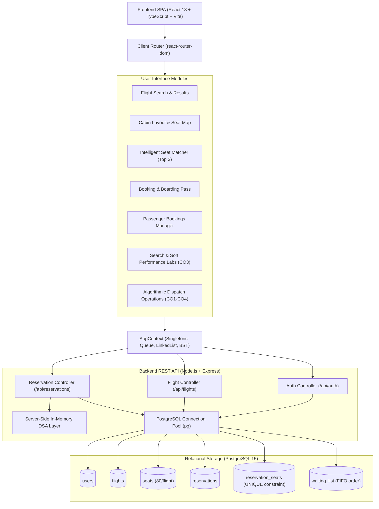

# FlySmart — Airline Seat Reservation System & DSA Laboratory

> **Academic Project Identity**:
> **Airline Seat Reservation System Using Queue, Linked List, BST and Selection Sort with Intelligent Seat Recommendation**
> 
> *A full-stack Commercial Airline Reservation System coupled with a rigorous Data Structures & Algorithms (DSA) demonstration laboratory.*

---

## ✈️ System Overview

FlySmart is an enterprise-grade full-stack aviation application designed to demonstrate practical applications of fundamental computer science data structures and algorithmic complexity evaluation.

The system features a **Dual-Persona Architecture**:
1. **Commercial Passenger Portal**: Authentic airline booking experience covering flight search, real-time aircraft cabin seat selection, explainable multi-factor seat recommendations, e-ticket generation, booking management, and a FIFO waiting list for fully booked sectors.
2. **Academic Technical Core & Performance Laboratories**: Dedicated interactive visualizers for Course Outcome (CO) validation, demonstrating step-by-step sorting, live tree traversals, search comparison metrics, and empirical benchmarking labs.

---

## 📚 Final Course Outcome (CO) Mapping

| Outcome Code | Focus Area | Implementation | Practical Aviation Application | Complexity |
| :--- | :--- | :--- | :--- | :--- |
| **CO1** | Linear Abstract Data Types | **FIFO Queue** (`Queue.ts` / `Queue.js`) | Ticket booking request intake & fair waiting list buffer on full flights | $O(1)$ Enqueue / Dequeue |
| **CO2** | Dynamic Node-Linked Structures | **Singly Linked List** (`LinkedList.ts` / `LinkedList.js`) | Dynamic in-memory passenger manifest with head and tail pointers | $O(1)$ Tail Insert, $O(n)$ Search |
| **CO3** | Searching & Sorting Performance Evaluation | **Selection Sort** & **Search Performance Lab** | In-place airfare sorting ($O(n^2)$) and empirical comparison of Sequential vs. BST Search ($N=10$ to $10,000$) | $O(n^2)$ Sort, $O(n)$ vs $O(\log n)$ Search |
| **CO4** | Tree Hierarchies & Indexing | **Binary Search Tree** (`BST.ts` / `BST.js`) | Booking reference PNR indexing, path tracing, comparison counting, and in-order dump | $O(\log n)$ Average Search |
| **CO5** | Graph Algorithms & Route Traversal | **NOT IMPLEMENTED** | Preserved as honest future enhancement (multi-hub flight route network optimization) | *Future Scope* |
| **Innovation** | Multi-Factor Heuristic Optimization | **Intelligent Seat Recommendation Engine** | Top-3 ranked seat allocation based on weighted ergonomic cabin constraints | $O(m)$ Cabin Evaluation |

> **Academic Invariant Notes**:
> - **CO4**: BST is primarily mapped to CO4 as a hierarchical tree structure. Empirical search comparisons between BST and Linked List also contribute to CO3.
> - **CO5**: Graph algorithms are **NOT implemented** in this micro-project. We explicitly preserve graph route traversal as future architectural scope rather than falsely claiming it.
> - **Selection Sort**: Implemented manually with step-by-step comparison and swap tracking. Never calls `Array.prototype.sort()`.
> - **Seat Recommendation**: A transparent, deterministic multi-factor heuristic scoring algorithm (not black-box or generative AI).

---

## 🏗️ System Architecture



---

## 🔬 Dedicated Performance Laboratories (CO3)

### 1. Search Performance Lab (`/dsa/search-lab`)
- Compares **Linked List Sequential Search ($O(n)$)** vs. **Binary Search Tree Search ($O(\log n)$)**.
- Dataset sizes: $N \in \{10, 50, 100, 500, 1000, 5000, 10000\}$.
- Evaluates Best-Case, Average-Case, and Worst-Case scenarios.
- Measures real operation counts and actual execution times without fabrication.

### 2. Selection Sort Performance Lab (`/dsa/sort`)
- Benchmarks manual Selection Sort across datasets $N \in \{10, 50, 100, 500, 1000, 5000\}$.
- Demonstrates quadratic operation growth: exactly $\frac{n(n-1)}{2}$ comparisons.
- Interactive Visualizer mode provides single-step walkthrough with active comparison and minimum index highlights.

---

## 🔄 Cancellation & Waiting List Synchronization (CO1 & CO2)

When a confirmed booking is cancelled:
1. Reservation status transitions to `cancelled`.
2. Physical seat in database transitions to `available`.
3. Passenger node is spliced out of the dynamic Linked List manifest ($O(n)$ search + $O(1)$ unlinking).
4. The system checks the flight's **FIFO Waiting Queue**.
5. If waiting passengers exist, the first waiting passenger is automatically promoted to confirmed status and assigned the vacated seat.

---

## 🚀 Quick Start & Installation

### Option 1: Native Local Run (Frontend + Backend)

#### Prerequisites:
- Node.js 18+ and npm installed.

#### Launch with Single Command:
```bash
# From project root
npm run dev
```
- **Frontend**: [http://localhost:5173](http://localhost:5173)
- **Backend API**: [http://localhost:5000](http://localhost:5000)

---

### Option 2: Containerized Docker Deployment

FlySmart provides a full multi-container Docker configuration (`docker-compose.yml`):

```bash
# Build and start frontend, backend, and PostgreSQL in isolated containers
docker compose up --build -d

# Verify container statuses and healthchecks
docker compose ps
```
- **Web Interface**: [http://localhost:5173](http://localhost:5173)
- **REST API Health**: [http://localhost:5000/api/health](http://localhost:5000/api/health)
- **PostgreSQL**: `localhost:5432` (Credentials: `postgres` / `postgres`, DB: `airline_dsa`)

To stop containers:
```bash
docker compose down
```

---

## 🧪 Automated Test Verification

| Test Suite | File / Scope | Runner | Test Count | Status |
| :--- | :--- | :--- | :--- | :--- |
| **Frontend DSA Suite** | `src/algorithms/__tests__/dsa.test.ts` | Vitest / Node | 14 tests | ✅ 100% Pass |
| **Backend Auth Suite** | `backend/tests/auth.test.js` | Node Native Runner | 8 tests | ✅ 100% Pass |
| **Backend DSA Suite** | `backend/tests/dsa.test.js` | Node Native Runner | 8 tests | ✅ 100% Pass |
| **Backend Flights Suite** | `backend/tests/flights.test.js` | Node Native Runner | 6 tests | ✅ 100% Pass |
| **Backend Reservations Suite**| `backend/tests/reservations.test.js`| Node Native Runner | 11 tests | ✅ 100% Pass |
| **TypeScript Compilation**| Project Root (`tsconfig.json`) | `tsc --noEmit` | Strict | ✅ 0 Errors |

To execute tests:
```bash
# Frontend DSA tests
npm test -- --run

# Backend API integration tests
cd backend && npm test
```

---

## 📖 Complete Documentation Suite

Comprehensive architecture specifications and technical reports are available in the `docs/` folder:
- [System Architecture Specification (`docs/ARCHITECTURE.md`)](docs/ARCHITECTURE.md)
- [RESTful API Documentation (`docs/API_DOCUMENTATION.md`)](docs/API_DOCUMENTATION.md)
- [Relational Database Schema & DDL (`docs/DATABASE_SCHEMA.md`)](docs/DATABASE_SCHEMA.md)
- [Data Structures & Algorithms Specifications (`docs/DSA_SPECIFICATIONS.md`)](docs/DSA_SPECIFICATIONS.md)
- [Verification & Testing Guide (`docs/TESTING.md`)](docs/TESTING.md)
- [Containerized Docker Setup Guide (`docs/DOCKER_SETUP.md`)](docs/DOCKER_SETUP.md)
- [Academic Course Outcome (CO) Mapping & Viva Tips (`docs/CO_MAPPING.md`)](docs/CO_MAPPING.md)

---

## 🎓 College Viva Voce Defense Tips

1. **Queue (CO1)**: Explain that JavaScript `Array.shift()` takes $O(n)$ time due to memory re-indexing. Our pointer-based linked queue guarantees strict $O(1)$ constant time for both enqueue and dequeue.
2. **Linked List (CO2)**: Highlight that passenger manifests expand dynamically at runtime without contiguous memory reallocation. Splicing cancelled passengers takes $O(1)$ once found.
3. **Selection Sort vs Array.sort (CO3)**: Clarify that `Array.sort()` uses TimSort ($O(n \log n)$). We implemented Selection Sort manually to study quadratic $O(n^2)$ behavior and track every comparison and swap step.
4. **Search Performance Lab (CO3)**: Point out that empirical data proves $O(\log n)$ tree search requires only ~14 comparisons at $N=10,000$ compared to ~5,000 comparisons in a linear search.
5. **BST (CO4)**: Emphasize that numeric booking keys (`B1001` $\to 1001$) are stored in a hierarchical tree. In-order traversal outputs all bookings in sorted order in $O(n)$ time.
6. **CO5 Status**: Proudly and honestly declare that Graph Route Traversal is preserved as future scope, demonstrating academic integrity.
