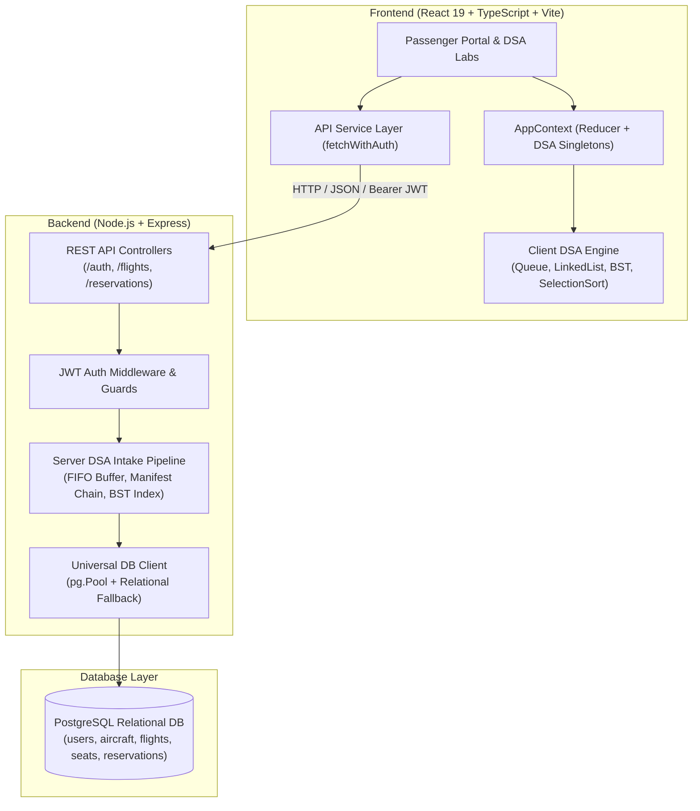

# FlySmart Aviation System - Full-Stack Airline Reservation & DSA Platform

FlySmart is an enterprise-grade full-stack Airline Seat Reservation System coupled with an interactive Data Structures & Algorithms (DSA) demonstration laboratory. Built with React 19, TypeScript, Tailwind CSS, Node.js/Express, and PostgreSQL, the platform bridges real-world travel engineering with rigorous computer science fundamentals.

---

## ✈️ System Overview

The application features a strict **Dual-Persona Architecture**:
- **Passenger Portal**: Clean, restrained, authentic commercial aviation interface for flight search, interactive seat selection, e-ticket issuance, and reservation management.
- **Academic Technical Core**: Dedicated interactive visualizers for Course Outcome (CO) validation, demonstrating algorithmic invariants, traversal paths, step-by-step sorting, and complexity metrics.

---

## 🏗️ Architecture



---

## 📚 DSA Course Outcomes (CO)

| Code | Algorithm / ADT | Implementation | Practical Aviation Application | Complexity |
| :--- | :--- | :--- | :--- | :--- |
| **CO1** | **FIFO Queue** | `Queue.ts` / `Queue.js` | Booking request intake buffering & fair concurrency handling | $O(1)$ Enqueue / Dequeue |
| **CO2** | **Singly Linked List** | `LinkedList.ts` / `LinkedList.js` | Dynamic in-memory passenger manifest management | $O(1)$ Tail Insert, $O(n)$ Search |
| **CO3** | **Binary Search Tree** | `BST.ts` / `BST.js` | High-speed booking reference ID lookup with path tracking | $O(\log n)$ Average Search |
| **CO3** | **Selection Sort** | `SelectionSort.ts` / `SelectionSort.js` | Flight airfare ordering by lowest price invariant without `Array.sort` | $O(n^2)$ Time, $O(1)$ Space |
| **Innovation** | **AI Recommendation**| `seatRecommendation.ts` | Multi-factor heuristic scoring engine for seat allocation | $O(m)$ Seat Evaluation |

---

## 🚀 Quick Start (Single Command Full-Stack Run)

You can launch the **entire full-stack application (both Backend & Frontend simultaneously)** with a single command from the project root:

```bash
npm run dev
```

This automatically:
1. Spins up the **Express REST API Backend** on `http://localhost:5000`
2. Spins up the **React 19 + Vite Frontend** on `http://localhost:5173`
3. Pipes unified color-coded logs to your terminal
4. Gracefully shuts down both processes together when you press `Ctrl+C`

Open your browser and navigate to **`http://localhost:5173`**.

---

### Separate Component Startup (Optional)

If you prefer running services independently in separate terminals:

#### Terminal 1: Backend
```bash
npm run dev:backend
# Starts Express server on http://localhost:5000
```

#### Terminal 2: Frontend
```bash
npm run dev:frontend
# Starts Vite frontend on http://localhost:5173
```

---

## 🧪 Test Verification Matrix

| Test Suite | Location | Test Runner | Total Tests | Status |
| :--- | :--- | :--- | :--- | :--- |
| **Frontend DSA Tests** | `src/algorithms/__tests__/dsa.test.ts` | Node Test Runner | 14 tests | ✅ 100% Pass |
| **Backend Auth Suite** | `backend/tests/auth.test.js` | Node Test Runner | 8 tests | ✅ 100% Pass |
| **Backend DSA Suite** | `backend/tests/dsa.test.js` | Node Test Runner | 8 tests | ✅ 100% Pass |
| **Backend Flights Suite** | `backend/tests/flights.test.js` | Node Test Runner | 6 tests | ✅ 100% Pass |
| **Backend Reservations Suite**| `backend/tests/reservations.test.js`| Node Test Runner | 8 tests | ✅ 100% Pass |
| **Client Production Build**| `dist/` | Vite | 1939 modules | ✅ Zero Errors |
| **Code Linter** | Project Root | Oxlint | 77 files | ✅ Zero Errors |

---

## 📖 Detailed Documentation

- [REST API Documentation](docs/API_DOCUMENTATION.md)
- [Relational Database Schema](docs/DATABASE_SCHEMA.md)
- [DSA & Algorithm Specifications](docs/DSA_SPECIFICATIONS.md)
- [Database DDL Schema Script](database/schema.sql)
- [Database Seed Script](database/seed.sql)

---

## 🛡️ Concurrency & Integrity Safety

The system guarantees that two concurrent users cannot double-book the same seat on any flight through:
1. **FIFO Intake Buffering**: Booking transactions are queued sequentially in memory.
2. **Relational Database Constraint**: `reservation_seats` enforces a `UNIQUE(seat_id)` constraint on confirmed reservations, rejecting race conditions with HTTP `409 Conflict`.
3. **Dual Validation**: Both client-side state machine and backend transaction verify seat availability before issuing boarding passes.
