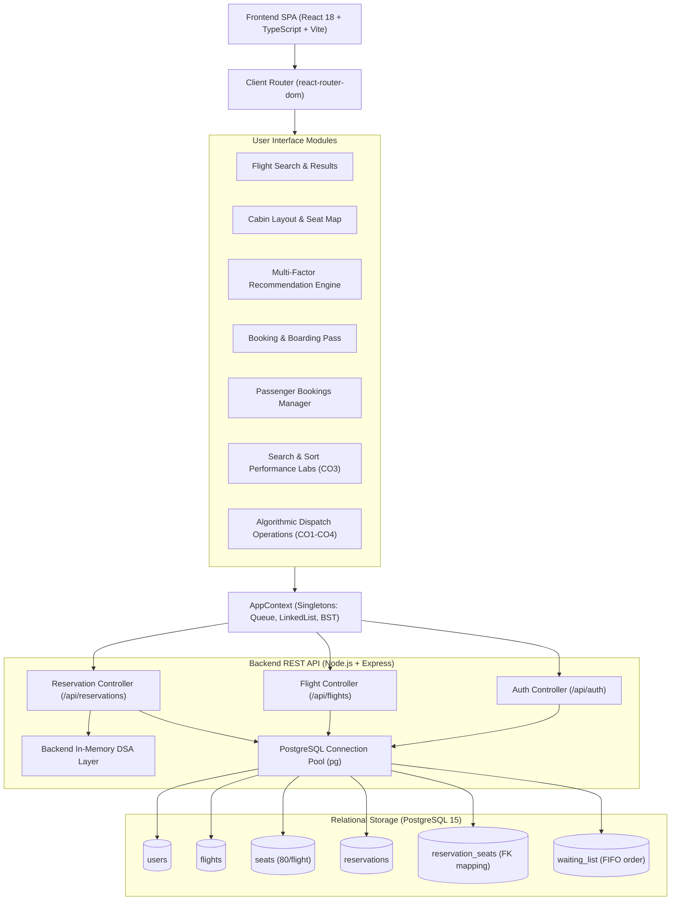
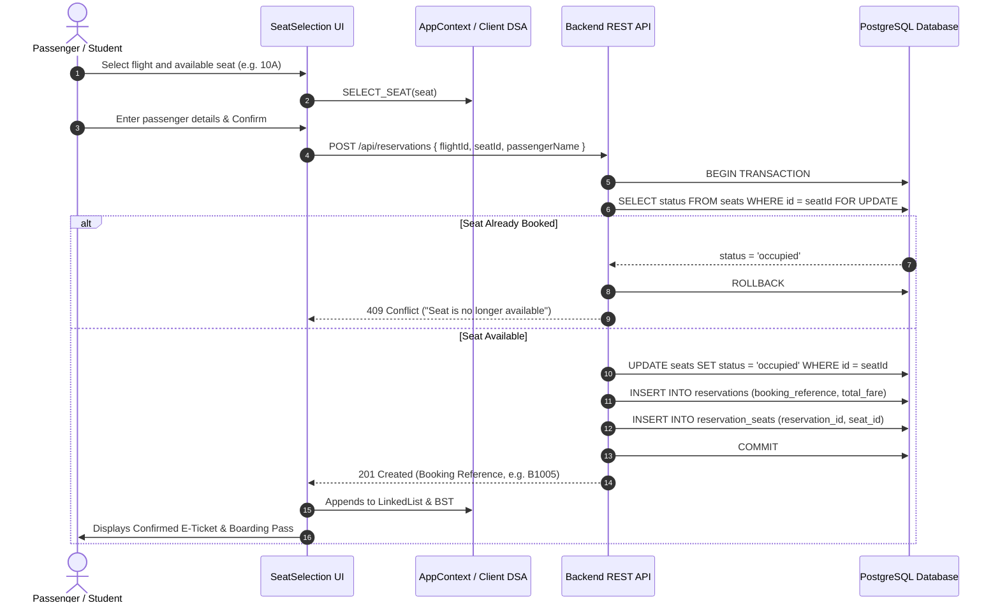

# FlySmart Aviation System - System Architecture

This document provides a comprehensive technical architectural specification of the **FlySmart Airline Seat Reservation System & DSA Laboratory**.

---

## 1. High-Level System Architecture

The application adopts a decoupled client-server architecture with an integrated relational database and pure, unpolluted Data Structures & Algorithms implementations on both tiers.



---

## 2. Dual Operational Execution Modes

FlySmart is engineered to run seamlessly in two distinct execution modes:

### Mode A: Integrated Full-Stack Production Mode
- **Frontend**: Serves static SPA from Nginx on port `5173` or `80`.
- **Backend API**: Express server runs on port `5000`.
- **Database**: PostgreSQL 15 stores users, flights, seat maps, active reservations, and waiting lists.
- **Transactions**: Atomic `BEGIN ... COMMIT` blocks ensure seat reservation, seat availability status, and FIFO waiting list promotions occur atomically.

### Mode B: Standalone Academic Demonstration Mode
- When running without a live database or network connection, the frontend operates completely offline.
- Client-side DSA singletons (`Queue<TicketRequest>`, `LinkedList<Passenger>`, `BinarySearchTree`) and `localStorage` mock caches maintain complete system state.
- Demonstrations of FIFO enqueue/dequeue, linked list node additions/deletions, BST traversals, selection sort passes, and empirical search benchmarking are 100% functional without external network dependencies.

---

## 3. Core Operational Workflows

### 3.1 Reservation & Seat Allocation Workflow


### 3.2 Cancellation & FIFO Waiting List Promotion Workflow
```mermaid
sequenceDiagram
    autonumber
    actor User as Passenger
    participant UI as MyBookings UI
    participant API as Backend REST API
    participant DB as PostgreSQL Database
    participant Queue as FIFO Waiting Queue (CO1)

    User->>UI: Click Cancel Booking (B1001)
    UI->>API: DELETE /api/reservations/:id
    API->>DB: BEGIN TRANSACTION
    API->>DB: UPDATE reservations SET status = 'cancelled'
    API->>DB: UPDATE seats SET status = 'available'
    API->>DB: SELECT * FROM waiting_list WHERE flight_id = ? ORDER BY queue_position ASC LIMIT 1
    alt Waiting Passenger Present in Queue
        DB-->>API: Passenger P201 (Waiting)
        API->>DB: UPDATE waiting_list SET status = 'promoted'
        API->>DB: UPDATE seats SET status = 'occupied'
        API->>DB: INSERT INTO reservations (for promoted passenger)
        API->>DB: COMMIT
        API-->>UI: 200 OK (Reservation cancelled; waiting passenger promoted)
    else No Waiting Passenger
        API->>DB: COMMIT
        API-->>UI: 200 OK (Reservation cancelled; seat returned to inventory)
    end
```

---

## 4. Academic Course Outcome (CO) Architectural Invariants

1. **CO1 - FIFO Queue**:
   - `src/algorithms/Queue.ts` implements a pointer-linked queue maintaining $O(1)$ `enqueue()` at `tail` and $O(1)$ `dequeue()` from `head`.
   - Used for ticket intake requests and waiting-list queueing on full flights.

2. **CO2 - Singly Linked List**:
   - `src/algorithms/LinkedList.ts` implements a dynamic pointer list with head and tail pointers.
   - Used for the passenger manifest. Allows dynamic check-in and cancellation without array reallocation.

3. **CO3 - Searching & Sorting Performance Evaluation**:
   - `src/algorithms/SelectionSort.ts` implements manual in-place minimum selection sort with comparison and swap tracking. Never calls `Array.prototype.sort()`.
   - `src/pages/SearchPerformanceLab.tsx` conducts empirical searches comparing Linked List $O(n)$ sequential search vs. BST $O(\log n)$ tree search across deterministic datasets from $N = 10$ to $10,000$.

4. **CO4 - Binary Search Tree**:
   - `src/algorithms/BST.ts` implements a hierarchical search tree for booking reference keys (`B1001` $\to 1001$).
   - Returns exact comparison counts, search paths (`[1005, 1002, 1003]`), and in-order sorted traversals.

5. **CO5 - Graph Route Traversal (NOT IMPLEMENTED)**:
   - Preserved as future architectural scope (e.g., Dijkstra route optimization across multi-city hub networks). Not falsely claimed in the current micro-project.

---

## 5. Security & Concurrency Controls
- **Bcrypt Password Hashing**: Passwords stored with 10 salt rounds.
- **JWT Authorization**: 24-hour stateless signed tokens verified via middleware.
- **Concurrency & Double-Booking Prevention**: Single-client PostgreSQL transactions (`withTransaction`) utilize pessimistic row locking (`SELECT ... FOR UPDATE` on `seats`) and atomic conditional state transitions (`UPDATE seats ... WHERE status = 'available'`) to prevent double-booking while preserving historical cancelled reservations.
- **Rate Limiting**: In-memory rate limiting shields sensitive auth and booking endpoints.
