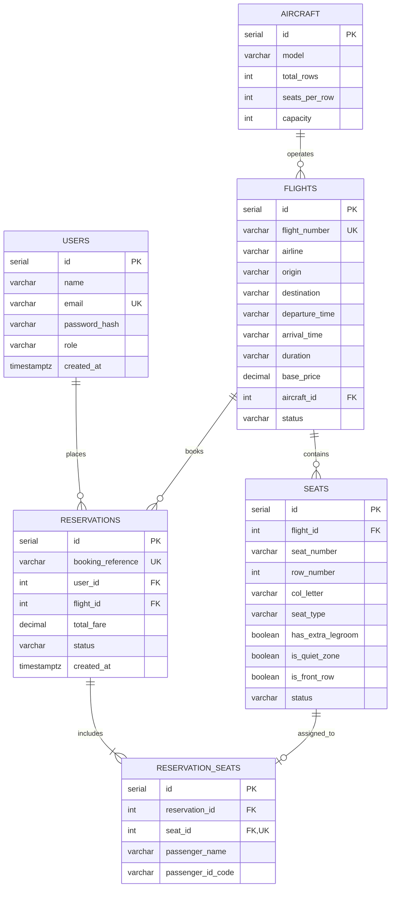

# FlySmart Aviation System - Relational Database Schema

This document details the normalized relational database architecture designed for PostgreSQL in the FlySmart Airline Seat Reservation System.

## 1. Entity-Relationship Diagram

---

## 2. Table Specifications & Constraints

### 2.1 `users` Table
Stores registered passengers and administrators.

| Column | Type | Constraints | Description |
| :--- | :--- | :--- | :--- |
| `id` | `SERIAL` | `PRIMARY KEY` | Unique internal user identifier |
| `name` | `VARCHAR(100)` | `NOT NULL` | Passenger or administrator full name |
| `email` | `VARCHAR(150)` | `UNIQUE, NOT NULL` | Login email credential |
| `password_hash` | `VARCHAR(255)` | `NOT NULL` | Bcrypt password hash (10 salt rounds) |
| `role` | `VARCHAR(20)` | `DEFAULT 'passenger' CHECK (role IN ('passenger', 'admin'))` | Role-based authorization guard |
| `created_at` | `TIMESTAMPTZ` | `DEFAULT CURRENT_TIMESTAMP` | Account registration timestamp |

---

### 2.2 `aircraft` Table
Maintains fleet specifications and seating geometry.

| Column | Type | Constraints | Description |
| :--- | :--- | :--- | :--- |
| `id` | `SERIAL` | `PRIMARY KEY` | Fleet equipment ID |
| `model` | `VARCHAR(50)` | `NOT NULL` | E.g., `Airbus A320neo`, `Boeing 737-800` |
| `total_rows` | `INT` | `DEFAULT 20` | Total seat rows |
| `seats_per_row` | `INT` | `DEFAULT 4` | Seats per row (A, B, C, D) |
| `capacity` | `INT` | `DEFAULT 80` | Total passenger seating capacity |

---

### 2.3 `flights` Table
Stores scheduled commercial flight routes, timetables, and pricing.

| Column | Type | Constraints | Description |
| :--- | :--- | :--- | :--- |
| `id` | `SERIAL` | `PRIMARY KEY` | Unique flight schedule identifier |
| `flight_number` | `VARCHAR(20)` | `UNIQUE, NOT NULL` | Standard IATA code (e.g. `AI-201`, `6E-402`) |
| `airline` | `VARCHAR(100)` | `NOT NULL` | Carrier name (e.g. `Air India`, `IndiGo`) |
| `origin` | `VARCHAR(100)` | `NOT NULL` | Departure city |
| `destination` | `VARCHAR(100)` | `NOT NULL` | Arrival destination city |
| `departure_time`| `VARCHAR(10)` | `NOT NULL` | Departure time (HH:MM) |
| `arrival_time` | `VARCHAR(10)` | `NOT NULL` | Arrival time (HH:MM) |
| `duration` | `VARCHAR(20)` | `NOT NULL` | Flight duration (e.g. `1h 30m`) |
| `base_price` | `NUMERIC(10,2)` | `NOT NULL CHECK (base_price > 0)` | Base ticket airfare in INR |
| `aircraft_id` | `INT` | `REFERENCES aircraft(id)` | Operating aircraft reference |
| `status` | `VARCHAR(20)` | `DEFAULT 'scheduled' CHECK (status IN ('scheduled', 'departed', 'completed', 'cancelled'))` | Flight operational status |

---

### 2.4 `seats` Table
Contains every individual physical seat across each flight layout (80 seats per flight).

| Column | Type | Constraints | Description |
| :--- | :--- | :--- | :--- |
| `id` | `SERIAL` | `PRIMARY KEY` | Unique seat identifier |
| `flight_id` | `INT` | `REFERENCES flights(id) ON DELETE CASCADE` | Associated flight schedule |
| `seat_number` | `VARCHAR(10)` | `NOT NULL` | Standard designation (e.g. `12A`, `1B`) |
| `row_number` | `INT` | `NOT NULL CHECK (row_number BETWEEN 1 AND 20)` | Row index |
| `col_letter` | `VARCHAR(2)` | `NOT NULL CHECK (col_letter IN ('A', 'B', 'C', 'D'))` | Column letter |
| `seat_type` | `VARCHAR(20)` | `NOT NULL CHECK (seat_type IN ('window', 'aisle', 'middle'))` | Seat position type |
| `has_extra_legroom`| `BOOLEAN` | `DEFAULT FALSE` | True for exit rows (1, 10, 20) |
| `is_quiet_zone`| `BOOLEAN` | `DEFAULT FALSE` | True for rear rows (15-20) |
| `is_front_row` | `BOOLEAN` | `DEFAULT FALSE` | True for rapid-exit rows (1-5) |
| `status` | `VARCHAR(20)` | `DEFAULT 'available' CHECK (status IN ('available', 'occupied', 'reserved'))` | Seat occupancy status |

---

### 2.5 `reservations` Table
Tracks ticket purchases, fare totals, and booking reference keys.

| Column | Type | Constraints | Description |
| :--- | :--- | :--- | :--- |
| `id` | `SERIAL` | `PRIMARY KEY` | Internal booking ID |
| `booking_reference`| `VARCHAR(20)` | `UNIQUE, NOT NULL` | Formatted booking code (e.g. `B1001`) |
| `user_id` | `INT` | `REFERENCES users(id) ON DELETE RESTRICT` | Account owner |
| `flight_id` | `INT` | `REFERENCES flights(id) ON DELETE RESTRICT` | Reserved flight schedule |
| `total_fare` | `NUMERIC(10,2)` | `NOT NULL` | Total fare paid in INR |
| `status` | `VARCHAR(20)` | `DEFAULT 'confirmed' CHECK (status IN ('confirmed', 'cancelled', 'completed'))` | Reservation state |
| `created_at` | `TIMESTAMPTZ` | `DEFAULT CURRENT_TIMESTAMP` | Transaction creation timestamp |

---

### 2.6 `reservation_seats` Table & Concurrency Enforcement
Maps physical seats to reservations while preserving historical records for cancelled bookings.

| Column | Type | Constraints | Description |
| :--- | :--- | :--- | :--- |
| `id` | `SERIAL` | `PRIMARY KEY` | Seat assignment identifier |
| `reservation_id`| `INT` | `REFERENCES reservations(id) ON DELETE CASCADE` | Parent reservation |
| `seat_id` | `INT` | `REFERENCES seats(id) ON DELETE RESTRICT` | Physical assigned seat |
| `passenger_name`| `VARCHAR(100)`| `NOT NULL` | Traveling passenger name |
| `passenger_id_code`| `VARCHAR(20)`| `NOT NULL` | System manifest code (e.g. `P101`) |

> **Concurrency Safety & Historical Audit Architecture**:
> To preserve full historical audit logs of cancelled reservations (`status = 'cancelled'`) and permit previously released seats to be booked again by new passengers, `reservation_seats` does not enforce an unconditional `UNIQUE(seat_id)` constraint across historical rows.
> 
> Instead, authoritative double-booking prevention is enforced via single-client PostgreSQL transactions (`withTransaction`):
> 1. A dedicated connection is acquired from the pool (`pool.connect()`) and initiates `BEGIN`.
> 2. The seat row is locked using `SELECT * FROM seats WHERE id = $1 AND flight_id = $2 FOR UPDATE`.
> 3. Availability is verified while holding the row lock (`seat.status === 'available'`).
> 4. An atomic state transition is executed: `UPDATE seats SET status = 'occupied' WHERE id = $1 AND status = 'available' RETURNING *`.
> 5. If another concurrent transaction acquired the seat first, zero rows are updated and the transaction is aborted with HTTP 409 Conflict (`SEAT_UNAVAILABLE`).
> 6. On cancellation, the seat is transitioned back (`UPDATE seats SET status = 'available' WHERE id = $1`), enabling seamless re-booking while preserving the historical reservation record.

---

### 2.7 `waiting_list` Table (CO1 FIFO Waiting Queue)
Maintains FIFO intake order for passengers desiring seats on 100% occupied flights.

| Column | Type | Constraints | Description |
| :--- | :--- | :--- | :--- |
| `id` | `SERIAL` | `PRIMARY KEY` | Unique waiting list record identifier |
| `flight_id` | `INT` | `REFERENCES flights(id) ON DELETE CASCADE` | Target fully-booked flight |
| `user_id` | `INT` | `REFERENCES users(id) ON DELETE CASCADE` | Registered passenger account |
| `passenger_name` | `VARCHAR(100)` | `NOT NULL` | Passenger name |
| `seat_preference` | `VARCHAR(20)` | `DEFAULT 'any'` | Desired seat type (window/aisle/any) |
| `queue_position` | `INT` | `NOT NULL` | Strict FIFO rank counter |
| `status` | `VARCHAR(20)` | `DEFAULT 'waiting' CHECK (status IN ('waiting', 'promoted', 'cancelled'))` | Queue status lifecycle |
| `created_at` | `TIMESTAMPTZ` | `DEFAULT CURRENT_TIMESTAMP` | Chronological enqueue timestamp |

